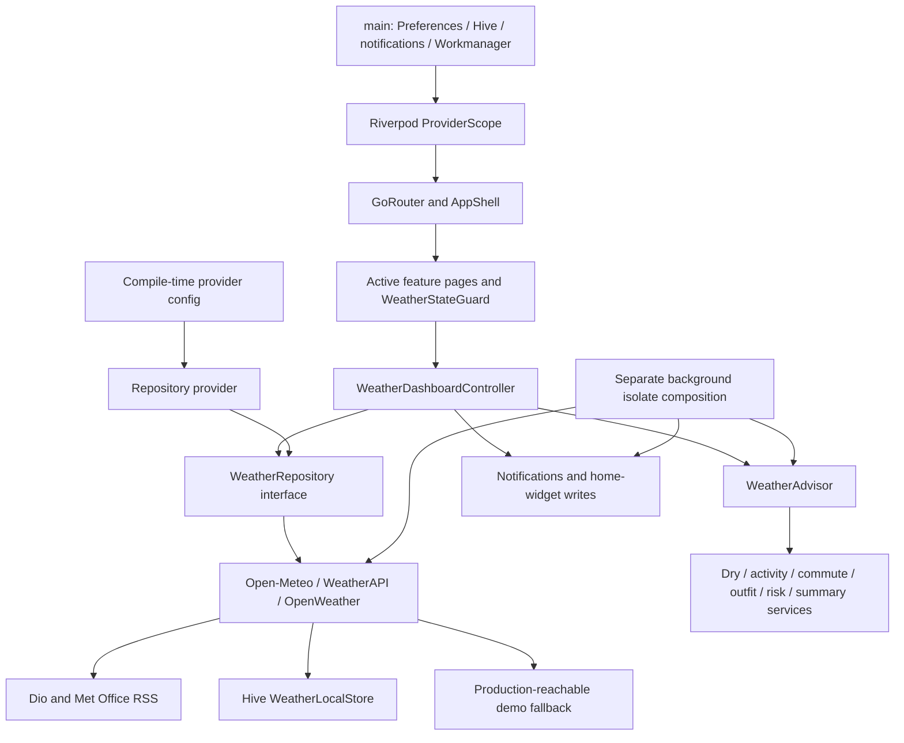

# Architecture assessment

Date: 29 October 2026. Source: audited revision `3baf32c`. Current-state descriptions are observed; target boundaries below are proposals awaiting review.

## Current flow

## Responsibility assessment

| Boundary | Existing seam | Keep / concern / direction |
| --- | --- | --- |
| Composition | `lib/main.dart`, `lib/core/providers/app_providers.dart`, `weather_core/data/weather_repository.dart` | Keep Riverpod DI and shared Dio lifecycle. Mandatory awaited plugin/bootstrap calls precede `runApp`; isolate optional platform failures and provide recoverable storage/startup states. |
| Presentation | Feature pages, `AppSurfaceCard`, `AtmosphericScaffold`, shared sheets | Keep modular screens. Dry-slot ranking still lives in presentation. Source/fallback/refresh failure is not surfaced consistently on active pages. |
| State orchestration | `weather_core/presentation/weather_dashboard_controller.dart` | Request serial guards prevent many obsolete refresh results. One controller also owns persistence, comparisons, guidance, notification evaluation and widget updates. Extract effects behind injectable ports as needed, without replacing all state management. A serial check occurs before awaited persistence; overlapping writes/results still deserve race tests. |
| Domain | `WeatherAdvisor` delegates to six feature services | Valuable deterministic heuristic foundation. `weather_models.dart` imports Flutter Material for `IconData`, and multiple domain services return `Icons`; the decision layer cannot currently run as pure Dart. Separate decision facts/reason identifiers from display labels/icons incrementally. |
| Repository | `WeatherRepository` exposes fetch/search; three implementations share a base class | Keep vendor adapters. Interface only returns a `WeatherReport`; errors, freshness, warning availability and capabilities have no typed contract. Base mixes network, RSS parsing, warning matching, numeric coercion, cache fallback and demos. Split along these responsibilities when tests establish behavior. |
| Provider normalization | Shared current/minute/hour/day models with explicit C/mm/kph fields | Retain units. Add interval semantics, nullable/unknown measurements where appropriate, UTC instants, location zone, capability/derivation metadata and strict essential-field validation. Missing data must not mean dry/calm. |
| Persistence | Hive JSON reports, selected/comparison place, routine windows; SharedPreferences flags | Preserve user values and version keys. Add migrations, bounded retention, cache schema/provider identity and explicit freshness policy. WeatherAPI normalizes location coordinates before caching, so requested versus returned cache identity needs tests. |
| Platform | Location/permission/notification/widget services and background worker | Keep adapters. Worker manually duplicates composition, hardcodes provider and preferences, opens the foreground Hive box and never closes it. Concurrent isolate access, resource cleanup and SDK/plugin behavior require device tests. |
| Routing | Explicit GoRouter paths and per-route AppShell | Keep GoRouter. No stateful tab shell or OS link configuration; notification initialization has no response callback/payload. Decide stack/back behavior and typed destination mapping before adding deep links. |

## Existing code to preserve

- The 13 one-line files under `features/weather/data`, `features/weather/domain` and its controller re-export `weather_core`; they are compatibility shims. Remove only after tracing and migrating imports.
- `weather_core/presentation/weather_shared_sheets.dart` re-exports the extracted sheets. Existing activity, location, routine and display sheets can remain shared components.
- Domain services already separate dry windows, activities, commute, outfit, risk and summary responsibilities. Extend or replace individual algorithms behind these seams.
- The legacy dashboard is unrouted, but contains useful radar, share, weekend, comparison and semantic UI implementations. Extract/reconnect tested pieces before deletion. Avoid routing the entire old page as an unreviewed replacement for current navigation.
- Freezed serialization, provider-aware cache keys, location permissions with manual search, quiet-hour preferences, cooldowns and simple/detailed explanations are existing value, subject to the identified correctness gaps.

## Proposed decision engine contract

The engine should accept explicit evaluation time, location IANA timezone, an ordered forecast series with represented intervals and known gaps, an activity profile, requested duration, earliest/latest acceptable times and any daylight requirement. It should return typed available/unsuitable/insufficient-data outcomes with interval coverage, limiting factors, applied thresholds and deterministic tie-breaking. An outcome must carry machine-readable reasons that a presenter turns into plain English.

Use UTC for ordering and durations; resolve calendar dates, recurring wall-clock times and daylight in the selected location's timezone. Define policies for repeated/missing DST times and cross-midnight routines. An hourly amount cannot justify a precise rain-start minute. A provider's native short-range data and data derived from hourly amounts must remain distinguishable. Probability is a forecast input; calibrated accuracy requires a separate observed-outcomes dataset and scoring methodology.

Keep this as a small pure-Dart module in the existing repository at first. A separate package is justified only if its dependency/test boundary or reuse provides a concrete benefit. Riverpod continues to compose the engine and services; widgets render immutable output. No backend is required for the engine itself.

## Alternatives and trade-offs

| Choice | Reason / cost |
| --- | --- |
| Incremental extraction and behavior characterization (recommended) | Protects working features and persistence. Temporary compatibility layers remain until migrated; requires deliberate tests for old/new result parity where behavior should stay the same. |
| Full application rewrite | Would discard useful code, reset UX/persistence behavior and increase regression risk. No demonstrated need. |
| Upgrade every dependency and architecture together | Could address SDK compatibility, but obscures causes of native failures. Repair a small compatible dependency set with explicit locked SDK/plugin evidence first. |
| Replace Riverpod / Dio / GoRouter / Freezed | Adds migration cost without an observed requirement. Retain existing integrations. |
| Add a backend immediately | Unnecessary for deterministic decisions. A restricted gateway may become necessary for provider key/licensing or optional remote alerts; decide only after provider contract review. |
| Statistical/ML suitability model immediately | There are no observed outcome labels or user feedback measurements. Explainable deterministic rules are auditable and testable now; calibration is a later measured activity. |

## Test and debugging seams

Use captured public provider fixtures and a fake Dio transport for contract/error tests. Supply a clock to engine, routine and notification evaluation rather than waiting for real time. Isolate cache storage behind tests covering corruption, expiration, provider identity and migrations. Use ProviderContainer overrides for state/race tests and platform service fakes for foreground widget tests. Retain native permission/background/notification delivery checks on real Android and iOS devices because Dart tests cannot establish OS scheduling guarantees.

Before refactoring a screen, trace its active route and its controller/service imports. For a wrong recommendation, inspect evaluation time/zone, provider provenance, interval bounds, missing values, threshold reasons and cache age. Do not debug provider failures by substituting demo data in production.
